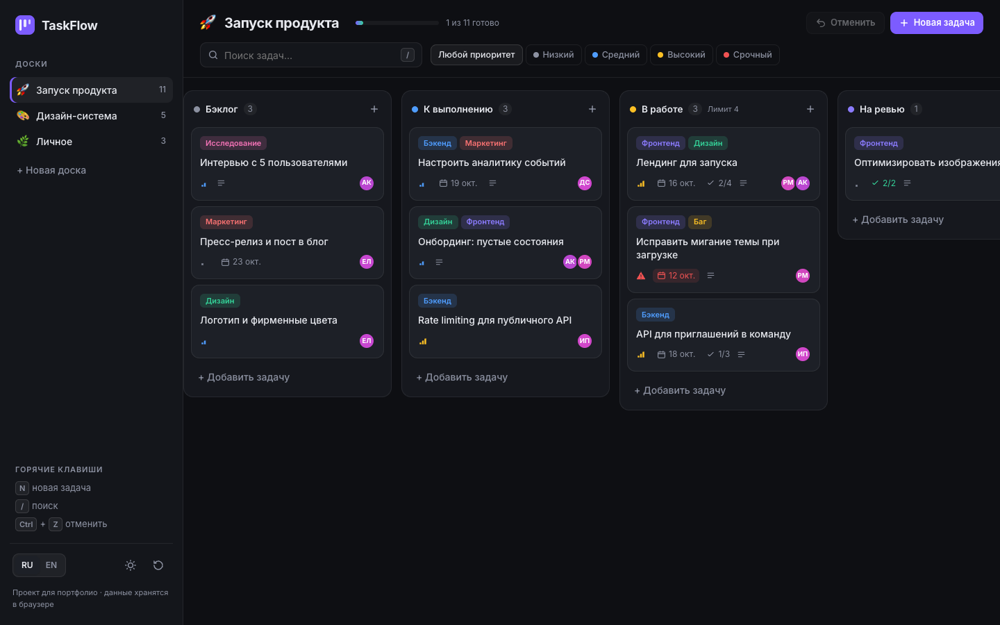
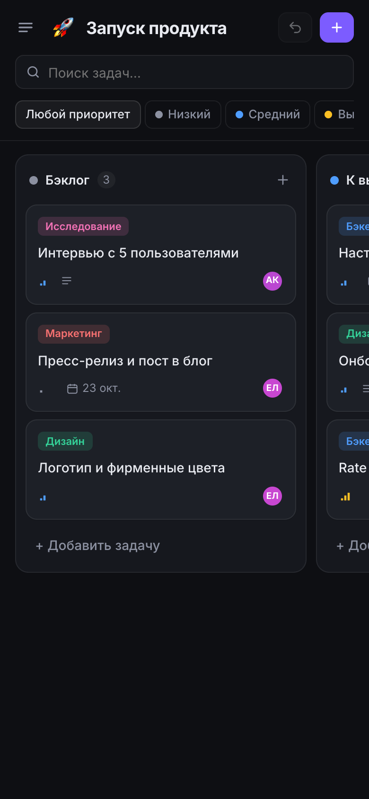

<div align="center">

# TaskFlow

**Канбан-приложение с drag & drop** · RU / EN

<a href="https://cdduke.github.io/taskflow-kanban/"></a>

     

&nbsp;

*🇬🇧 Kanban app — drag & drop with mouse, touch and keyboard, task drawer with checklists, undo history, dark/light theme.*

</div>

---

Веб-приложение для управления задачами в стиле Linear/Trello: несколько досок, перетаскивание карточек,
чек-листы, метки, сроки, исполнители, тёмная и светлая темы. **Интерфейс на русском и английском.**

**Стек:** React 19 · TypeScript (strict) · Zustand (+ persist) · dnd-kit · Vite · CSS-переменные

## Возможности

- **Drag & drop** между колонками и внутри колонки — мышью, пальцем (долгое нажатие) и **с клавиатуры**
  (пробел — взять, стрелки — двигать); озвучка для экранных читалок на двух языках
- **Отмена действий** (Ctrl/Cmd+Z, кнопка и toast «Задача удалена · Отменить») — история из 40 шагов,
  всё перетаскивание целиком — один шаг
- Карточка задачи в выдвижной панели: статус, приоритет, срок, метки, исполнители, описание, чек-лист с прогрессом
- Поиск по названию, описанию и меткам, фильтр по приоритету
- Лимит задач в работе (WIP) с подсветкой превышения, прогресс доски, подсветка просроченных сроков
- Несколько досок: создание, переименование (двойной клик), удаление; добавление и переименование колонок
- Горячие клавиши: `N` — новая задача, `/` — поиск, `Ctrl+Z` — отменить, `Esc` — закрыть
- Все данные сохраняются в `localStorage`; тема применяется **до первой отрисовки** (без мигания)
- Пока демо-данные не изменены, они переключаются вместе с языком интерфейса

## Технические детали

- Состояние — один стор Zustand; изменения делаются на глубокой копии (`structuredClone`),
  предыдущая версия уходит в историю для undo
- `useSortable` + `DragOverlay` + собственные сенсоры (Pointer с порогом, Touch с задержкой, Keyboard)
- Проверено на 390px и 1440px сценарием в headless Chrome: перетаскивание, отмена, панель задачи, смена темы и языка

## Запуск

```bash
npm install
npm run dev      # http://localhost:5177
npm run build    # tsc + сборка
```

---

*Portfolio project. Data is stored locally in your browser. Bilingual: Russian / English.*


**Демо:** https://cdduke.github.io/taskflow-kanban/
